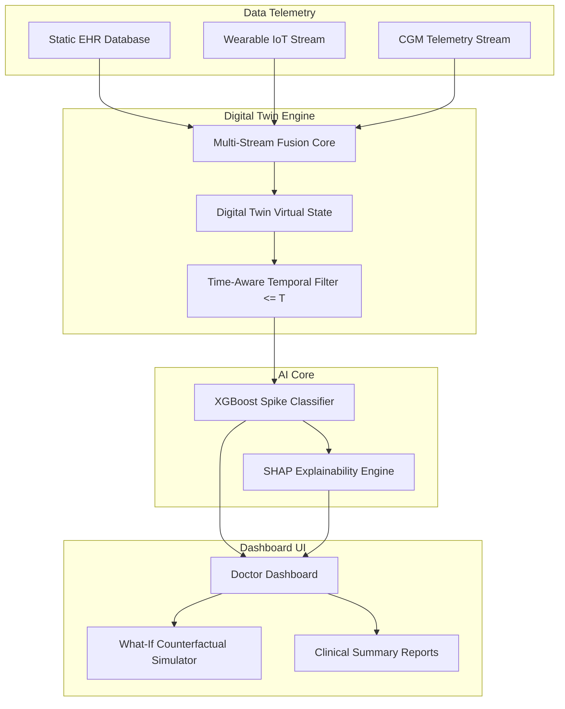

# GlucoTwin — AI Digital Twin for Early Prediction of Glucose Spikes

> **Happiest Health Digital Twin Challenge 2026 Competition Submission**  
> *A continuous, multi-stream Digital Twin system fusing static EHR profiles with dynamic wearable IoT telemetry to forecast 2-hour future glucose spikes in Type 2 Diabetes.*

---

## 1. One-Line Description
GlucoTwin is an AI-powered healthcare Digital Twin prototype that fuses static clinical EHR baselines with real-time wearable IoT streams to forecast 2-hour future glucose spike risks in Type 2 Diabetes.

## 2. Problem Statement
Type 2 Diabetes management suffers from reactive monitoring. Standard HbA1c lab tests reflect only a 3-month retrospective average, while Continuous Glucose Monitor (CGM) threshold alarms issue alerts *after* a glycemic excursion has already begun.

## 3. Solution
GlucoTwin creates a continuous virtual patient representation (Digital Twin) that combines static metabolic baselines with live IoT telemetry (Continuous Glucose, Heart Rate, Step Count, Sleep Duration, Stress, Meal Inputs) to predict glucose spikes **approximately 2 hours in advance**.

## 4. Why Digital Twin?
Unlike traditional static ML models, a Digital Twin maintains a continuous, time-aware virtual state of a patient. It tracks metabolic dynamics, enables counterfactual scenario simulation (e.g. testing step increases or carb reductions), and provides explainable early warnings.

## 5. Key Innovation
- **Multi-Stream Data Fusion**: Combines static EHR baselines with high-frequency wearable telemetry into a stateful Digital Twin object.
- **2-Hour Predictive Spike Horizon**: XGBoost classifier trained on temporal sliding window dynamics (3h/6h rolling slopes and averages).
- **SHAP Explainability**: Replaces black-box predictions with game-theoretic feature attributions.
- **What-If Scenario Simulator**: Interactive counterfactual engine allowing real-time risk recalculations.

## 6. System Architecture



## 7. Data
All datasets utilized in this project are strictly synthetic and anonymized to guarantee 100% patient privacy:
- `data/synthetic_ehr.csv`: 50 static patient records (Age, Sex, BMI, HbA1c, Fasting Glucose, History).
- `data/synthetic_wearable.csv`: 16,800 hourly wearable IoT records (Heart Rate, Steps, Sleep, Activity, Stress, Carbs).
- `data/synthetic_glucose.csv`: 16,800 continuous glucose measurements.
- `data/feature_dataset.csv`: 16,400 fused temporal feature rows.

## 8. Synthetic Data Generation
Generated reproducibly using `scripts/generate_synthetic_data.py` with fixed random seed `seed=42`. Sanity checks assert 0 missing values, 0 duplicate records, 50 matched patients, and an 18.16% target positive rate.

## 9. Machine Learning
Evaluated Logistic Regression, Random Forest, and XGBoost Classifier using `GroupShuffleSplit` (80% train patients, 20% test patients, 0 patient overlap) to evaluate generalization on unseen patient profiles. Decision threshold (`0.55`) was tuned on 5-fold GroupKFold train cross-validation.

## 10. Digital Twin
Implemented in `backend/digital_twin/twin_engine.py`. Maintains virtual patient state snapshots and supports timestamp queries (`GET /api/digital-twin/<id>?timestamp=<ISO_TIMESTAMP>`) with strict historical filtering to prevent data leakage.

## 11. Explainability
Integrated `shap.TreeExplainer` in `ml/inference/predict.py`. Computes exact feature attributions for every prediction, highlighting top risk drivers (e.g. 4h carb sum, recent glucose slope, 3h step sum).

## 12. What-If Simulation
The simulation engine (`POST /api/digital-twin/simulate`) permits interactive adjustment of step count, sleep duration, carb meal input, and stress level, recalculating predicted risk probabilities and risk deltas live via the trained model.

## 13. Dashboard
A modern React 19 + Tailwind CSS + Recharts doctor-facing dashboard providing patient selection (`GT-001`, `GT-002`, `GT-003`), visual data fusion diagram, vitals cards, time window selectors (6h, 12h, 24h), and printable clinical summary reports.

## 14. Empirical Model Results (Held-Out Test Set)

| Model Architecture | Precision | Recall | F1-Score | ROC-AUC | PR-AUC | Optimal Threshold |
| :--- | :---: | :---: | :---: | :---: | :---: | :---: |
| Logistic Regression | 0.3098 | 0.7172 | 0.4327 | 0.7468 | 0.3930 | 0.55 |
| Random Forest | 0.5298 | 0.7340 | 0.6154 | 0.8842 | 0.5807 | 0.55 |
| **XGBoost (Selected)** | **0.5000** | **0.8704** | **0.6351** | **0.9027** | **0.6239** | **0.55** |

- **Test True Positives (TP)**: 517 | **True Negatives (TN)**: 2,169
- **False Positives (FP)**: 517 | **False Negatives (FN)**: 77

## 15. Technology Stack
- **Frontend**: React (v19), Vite, Tailwind CSS, Recharts, Lucide React, Axios, React Router (v7).
- **Backend**: Python (3.13), Flask, REST API, Flask-CORS, Joblib.
- **Machine Learning**: scikit-learn, XGBoost, SHAP, pandas, numpy, matplotlib.

## 16. Project Directory Structure
```text
glucotwin-digital-twin-2026/
├── backend/
│   ├── app.py                  # Flask REST API Entrypoint
│   ├── config.py               # Flask Configuration
│   ├── digital_twin/
│   │   └── twin_engine.py      # Digital Twin Core State Engine
│   └── routes/
│       └── api.py              # API Endpoint Routes
├── data/                       # Synthetic Datasets
├── docs/                       # Comprehensive Documentation & Model Cards
│   ├── architecture.md
│   ├── data_dictionary.md
│   ├── demo_script.md
│   ├── digital_twin.md
│   ├── jury_questions.md
│   ├── model_card.md
│   ├── model_results.md
│   └── model_results/          # Evaluation Plots (.png)
├── frontend/                   # React Vite Dashboard
├── ml/
│   └── inference/
│       └── predict.py          # Inference & SHAP Engine
├── models/                     # Saved ML Model & Scaler Artifacts
├── scripts/
│   ├── generate_synthetic_data.py
│   └── train_model.py
├── tests/
│   └── test_full_suite.py       # Full Test Suite (10/10 Passed)
├── .env.example
├── .gitignore
├── LICENSE
├── README.md
└── requirements.txt
```

## 17. Installation

### Setup Environment
```bash
python -m venv venv
# On Windows:
venv\Scripts\activate
# On Linux/Mac:
source venv/bin/activate

pip install -r requirements.txt
```

### Setup Frontend
```bash
cd frontend
npm install
cd ..
```

## 18. Model & Data Generation
```bash
# 1. Regenerate reproducible synthetic data
python scripts/generate_synthetic_data.py

# 2. Execute leakage audit, threshold tuning, and model training
python scripts/train_model.py

# 3. Run full verification test suite
python -m unittest tests/test_full_suite.py
```

## 19. Running the Application

### Launch Backend Server
```bash
python backend/app.py
```
*Backend API server runs at `http://127.0.0.1:5000`.*

### Launch Frontend Dashboard
In a new terminal:
```bash
cd frontend
npm run dev
```
*Frontend runs locally at `http://localhost:5173`.*

## 20. API Endpoints

| Method | Endpoint | Description |
| :--- | :--- | :--- |
| `GET` | `/api/health` | API health check |
| `GET` | `/api/metrics` | Actual ML evaluation metrics |
| `GET` | `/api/patients` | List all synthetic demo patients |
| `GET` | `/api/patients/<id>` | Get static EHR profile |
| `GET` | `/api/digital-twin/<id>` | Get digital twin state (`?timestamp=` supported) |
| `GET` | `/api/wearables/<id>` | Get wearable time-series telemetry |
| `GET` | `/api/glucose/<id>` | Get continuous glucose telemetry |
| `POST` | `/api/digital-twin/simulate` | Execute what-if scenario simulation |
| `GET` | `/api/predictions/<id>` | Prediction audit history |
| `GET` | `/api/explainability/<id>` | SHAP feature attributions |
| `GET` | `/api/reports/<id>` | Clinical summary report |

## 21. Example Workflow
1. Open `http://localhost:5173/` and click **Launch Demo Dashboard**.
2. Select Synthetic Demo Patient **GT-001** (Alex Mercer).
3. Observe live multi-stream data fusion and **76.6% Model-Predicted Probability** (Higher Risk).
4. Navigate to **Explainability** to inspect top SHAP factors (`carbs_sum_4h`, `steps_sum_3h`).
5. Navigate to **Simulation** and increase activity to 8,000 steps to observe real-time risk reduction.

## 22. Limitations
- Synthetic data proof-of-concept; requires clinical trial validation on real patient cohorts.
- Hourly telemetry sampling frequency.

## 23. Ethical Considerations
- 100% synthetic anonymized data eliminates patient privacy risk.
- Explicit non-clinical labeling prevents misuse.

## 24. Medical Disclaimer
> **IMPORTANT NOTICE**: This application is a research and competition proof-of-concept using synthetic data. It has not been clinically validated and is not intended for diagnosis, treatment, or medical decision-making.

## 25. Screenshots
- `docs/model_results/confusion_matrix.png`
- `docs/model_results/roc_curve.png`
- `docs/model_results/pr_curve.png`
- `docs/model_results/feature_importance.png`

## 26. Demo Video
- `[DEMO VIDEO LINK PLACEHOLDER — Competition Presentation Recording]`

## 27. Team
- `Team Name: Thanmayeenadimpalli[— Happiest Health Digital Twin Challenge 2026 Entry]`

## 28. License
Distributed under the [MIT License](LICENSE).
