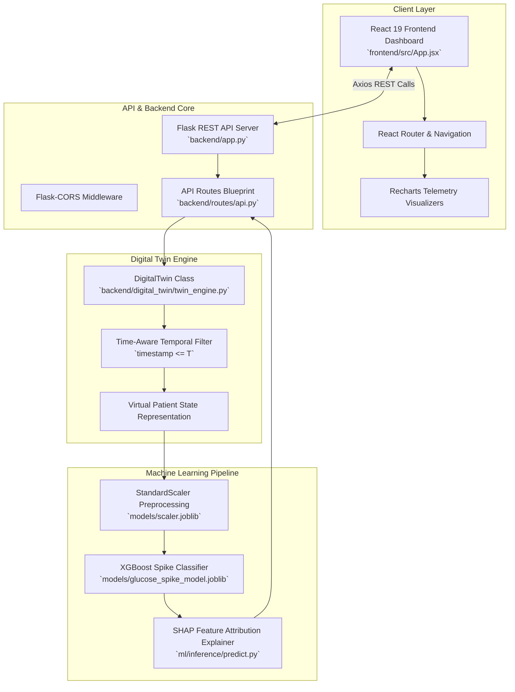
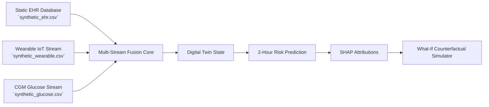

# GlucoTwin — Complete System Architecture & Pipeline Specification

> **Happiest Health Digital Twin Challenge 2026**  
> *End-to-End Modular Full-Stack Software & ML Architecture*

---

## 1. High-Level Component Flow

---

## 2. Multi-Stream Data Fusion Architecture

---

## 3. Module Breakdown

### Frontend (`frontend/`)
- Built with **React 19**, **Vite**, **Tailwind CSS**, **Recharts**, and **Lucide React**.
- Proxy configured in `vite.config.js` to route `/api/*` calls directly to `http://127.0.0.1:5000`.

### Backend API (`backend/`)
- **Flask REST API** handling JSON requests for patient profiles, digital twin states, telemetry series, simulations, prediction history, explainability, and metrics.

### Digital Twin Engine (`backend/digital_twin/`)
- Fuses static EHR records with time-series telemetry.
- Enforces strict temporal filtering ($\text{timestamp} \le T$) to prevent future data leakage.

### Machine Learning (`ml/` & `models/`)
- **XGBoost Classifier** (`models/glucose_spike_model.joblib`) trained on 40 patients and validated on 10 unseen test patients.
- **SHAP Explainer** providing instance-level feature attributions.
