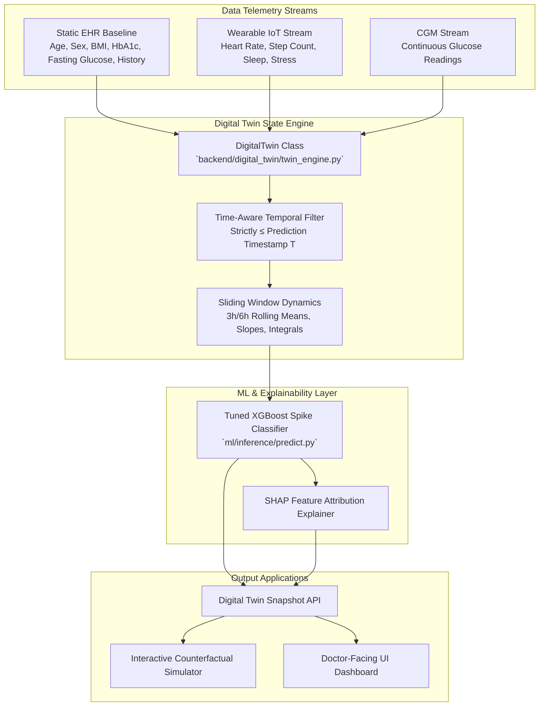

# Digital Twin Architecture & Engine Specification

> **Happiest Health Digital Twin Challenge 2026**  
> *Proof-of-Concept Virtual Patient State Representation Engine*

---

## 1. What a Digital Twin Means in GlucoTwin
In the context of GlucoTwin, a **Digital Twin** is a dynamic, continuously updated virtual representation of a synthetic patient's physiological and metabolic state. 

Traditional clinical practice relies on static, periodic check-ups (e.g. HbA1c tests every 3 months). In contrast, GlucoTwin continuously fuses static patient clinical baselines with real-time wearable IoT streams to track metabolic dynamics and forecast glycemic risks **approximately 2 hours in advance**.

---

## 2. Multi-Stream Data Fusion Architecture

---

## 3. Stateful Representation Schema
The `DigitalTwin` engine produces a structured snapshot containing:
- **Patient Identity & Demographics**: `patient_id`, `name`, `age`, `sex`, `bmi`, `hba1c`, `fasting_glucose`.
- **Medical History & Risk Factors**: `hypertension`, `family_history_diabetes`, `smoking_status`.
- **Current Dynamic Vitals**: `glucose_mgdl`, `heart_rate`, `steps`, `sleep_hours_last_night`, `stress_level`, `calories_burned`, `carbs_intake_g`.
- **Recent Trends**: 3-Hour Glucose Mean, Standard Deviation, and Slope.
- **2-Hour Spike Prediction**: Probability %, Risk Level (`Low`, `Moderate`, `High`), Threshold (`0.55`), Prediction Horizon.
- **Explainability**: Top SHAP feature attributions and human-readable explanation text.

---

## 4. Time-Aware Updates & Data Leakage Prevention
- **Temporal Constraint**: When a prediction is requested at timestamp $T$, the Digital Twin engine filters the wearable and CGM time-series data to strictly include records where $\text{timestamp} \le T$.
- **Zero Future Data Leakage**: Features at time $T$ utilize strictly historical information $\le T$. Future records $> T$ are hidden from the feature extractor.
- **No In-Memory Retraining**: Model weights are frozen artifacts loaded directly from disk (`models/glucose_spike_model.joblib`).

---

## 5. UI Risk Categorization Mapping
Model inference produces a continuous probability $P(\text{spike})$. Risk levels are mapped as follows:
- **High Risk**: $P \ge 0.55$ (Exceeds tuned classification threshold; 2-hour glucose spike predicted)
- **Moderate Risk**: $0.33 \le P < 0.55$ (Watch state; metabolic trend elevated)
- **Low Risk**: $P < 0.33$ (Stable state; normal glycemic range expected)

---

## 6. Regulatory & Proof-of-Concept Disclaimer
> *"The Digital Twin is a research/competition proof-of-concept using synthetic data and is not clinically validated."*
