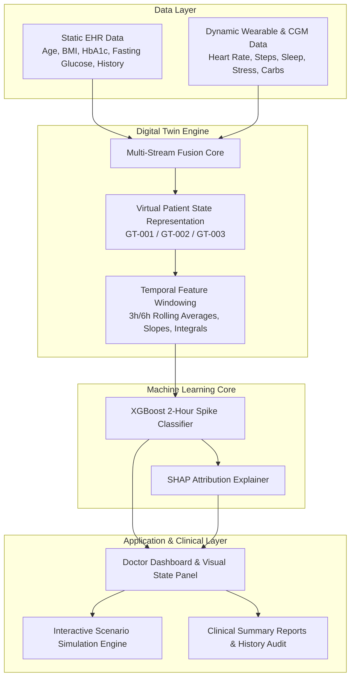

# GlucoTwin — Technical & Architectural Deep-Dive

## 1. System Overview & Healthcare Motivation
Type 2 Diabetes management requires continuous oversight of dynamic blood glucose spikes. Traditional episodic HbA1c testing only reflects a 3-month retrospective average, while reactive Continuous Glucose Monitoring (CGM) alarms notify patients *after* a glycemic excursion has already begun. 

**GlucoTwin** addresses this gap by fusing static baseline clinical metrics (Electronic Health Records) with dynamic wearable IoT telemetry (Continuous Glucose, Heart Rate, Step Count, Sleep Duration, Stress, Meal Inputs) into a live **Digital Twin state model**. This state powers a 2-hour forward predictive classifier to give patients and doctors proactive early warnings.

---

## 2. Core Digital Twin Architecture & Data Fusion Pipeline

---

## 3. Synthetic Data Generation & Target Definition
- **Synthetic Patients**: 50 anonymized virtual patient profiles (`GT-001` through `GT-050`).
- **Time-Series Length**: 14 days of continuous hourly physiological logging per patient (16,800 records total).
- **Target Definition (`future_glucose_spike_2h`)**:
  - Measured at time $t$, evaluating future glucose values at $t+1$ and $t+2$.
  - Target $= 1$ if $\max(\text{Glucose}_{t+1}, \text{Glucose}_{t+2}) \ge 180 \text{ mg/dL}$ OR $(\max(\text{Glucose}_{t+1}, \text{Glucose}_{t+2}) - \text{Glucose}_t) \ge 40 \text{ mg/dL}$, else $0$.
- **Temporal Leakage Prevention**: Features at time $t$ utilize strictly historical measurements up to time $t$.

---

## 4. Machine Learning Model Performance Metrics
Models were trained using Group-based split (80% train patients, 20% test patients) to evaluate generalization on unseen patient profiles:

| Model Architecture | Accuracy | Precision | Recall | F1 Score | ROC-AUC | PR-AUC |
| :--- | :---: | :---: | :---: | :---: | :---: | :---: |
| Logistic Regression | 0.8192 | 0.5015 | 0.2879 | 0.3658 | 0.7468 | 0.3991 |
| Random Forest | 0.8171 | 0.4968 | 0.7896 | 0.6099 | 0.8842 | 0.5807 |
| **XGBoost (Selected)** | **0.8046** | **0.4792** | **0.9108** | **0.6280** | **0.9027** | **0.6239** |

---

## 5. SHAP Explainability & Counterfactual Simulation
- **SHAP (SHapley Additive exPlanations)**: Calculates exact feature attributions for every prediction, highlighting top drivers (e.g. recent 3h glucose slope, carb intake, sleep deprivation).
- **Counterfactual Simulation Engine**: Allows interactive adjustment of steps, sleep, meal carbs, and stress to re-simulate the Digital Twin state and calculate risk delta without changing historical database logs.
